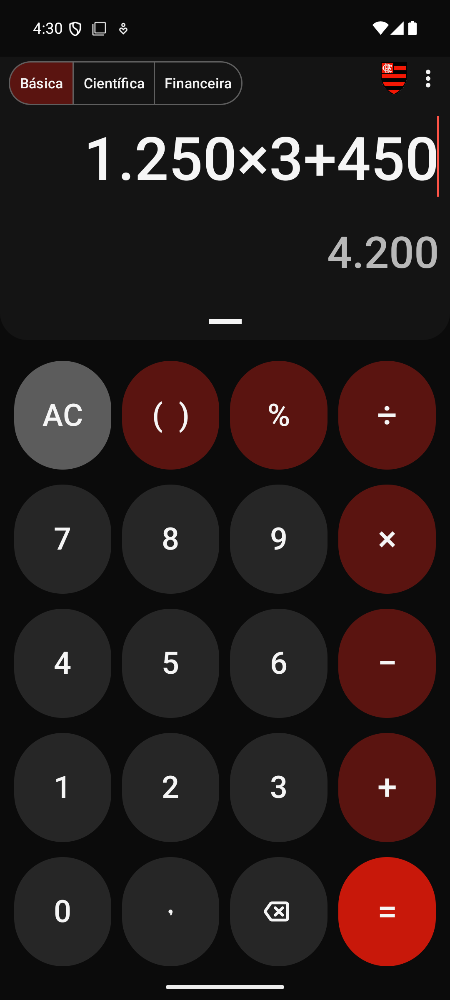
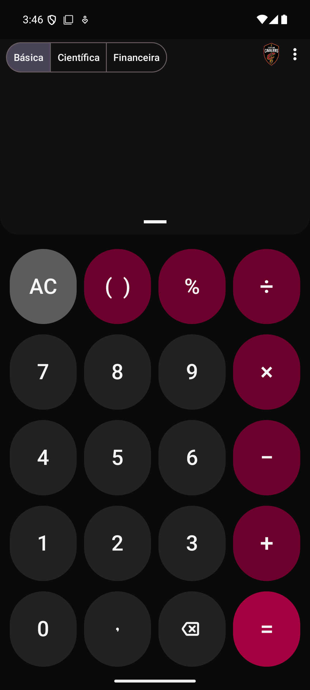
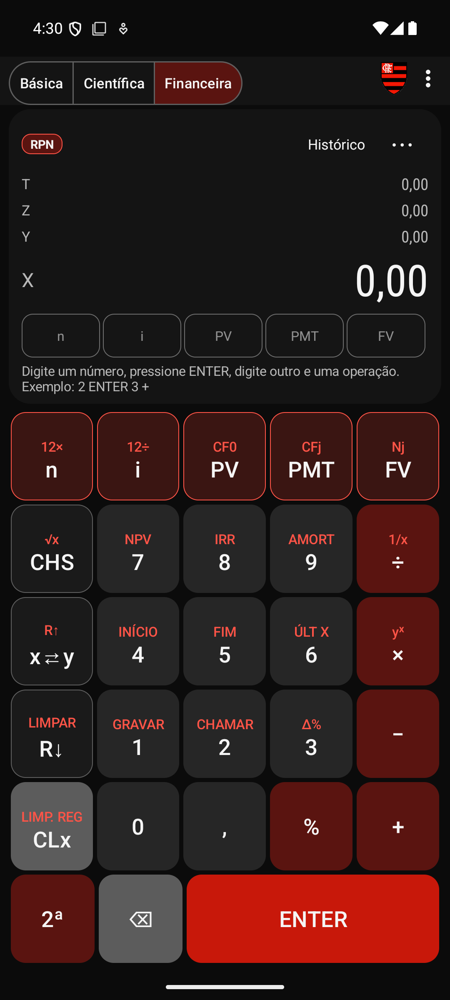
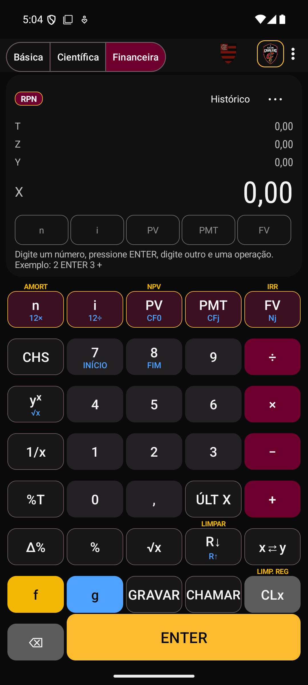

<div align="center">

# Calculadora Financeira RPN

### Calculadora básica, científica e financeira RPN para Android — pessoal, em português e sem internet.

<a href="LICENSE"></a>

</div>

> **Projeto pessoal.** O aplicativo **não será publicado em loja nenhuma**: é gerado como APK e instalado à mão no celular. Não tem anúncios, conta, login, compras, telemetria nem acesso à internet.
>
> "Calculadora Financeira RPN" é um nome de trabalho. O aplicativo não usa nome, logotipo, imagens ou desenho industrial de nenhuma calculadora comercial e não é afiliado a nenhum fabricante.

## Os três modos

Um único aplicativo, com um seletor sempre visível no topo. O último modo usado é restaurado ao abrir.

| Modo | O que oferece |
|---|---|
| **Básica** | `+ − × ÷`, porcentagem, parênteses, inverter sinal (toque longo em `−`), colar número válido, histórico, copiar resultado |
| **Científica** | tudo do básico, mais trigonometria (graus/radianos), logaritmos, potências, raízes de índice n, fatorial, π e e, módulo, inverso, memória M+/M−/MR/MC e resultado anterior |
| **Financeira RPN** | pilha X/Y/Z/T, TVM (`n`, `i`, `PV`, `PMT`, `FV`), pagamento no início ou no final, fluxo de caixa, **VPL** (`NPV`), **TIR** (`IRR`), amortização, conversão de taxas, memória 0–9 |

## Temas

Dois temas escuros, escolhidos em **Configurações → Tema**, aplicados na hora e lembrados ao reabrir:

| Flamengo | Cleveland Cavaliers |
|---|---|
|  |  |
|  |  |

Os temas só mudam a aparência; os motores de cálculo são os mesmos. Detalhes, cores e como trocar os logotipos: [docs/TEMAS.md](docs/TEMAS.md).

## Português e formato brasileiro

Toda a interface é em **português do Brasil**, sem seletor de idioma. Os números aparecem no formato do Brasil (`1.234.567,89`), mas os cálculos nunca usam texto localizado: veja [docs/FORMATACAO_NUMERICA.md](docs/FORMATACAO_NUMERICA.md). As siglas de calculadoras financeiras (`PV`, `FV`, `PMT`, `NPV`, `IRR`) ficam nos botões e vêm com a explicação em português (toque e segure a tecla).

## O modo RPN em um minuto

Em **RPN** (notação polonesa reversa) você digita primeiro os números e depois a operação; não existe `=`. `ENTER` separa dois números.

```
2 ENTER 3 +          →  5
```

Financiamento de 1.000 em 12 parcelas de 1 % ao mês:

```
1000 CHS PV
12 n
1 i
0 FV
PMT                  →  88,85
```

`CHS` troca o sinal. **Convenção de sinais:** dinheiro que entra é positivo e dinheiro que sai é negativo; PV e PMT precisam ter sinais opostos. O aplicativo **nunca troca um sinal sozinho**: se os sinais forem incompatíveis, ele explica o problema.

Guia completo: [docs/RPN_GUIDE.md](docs/RPN_GUIDE.md).

## Gerar o APK e instalar no celular

```powershell
.\tools\gerar-apk.ps1                 # APK de depuração (instala sem configurar nada)
.\tools\criar-chave-release.ps1       # uma vez: cria a chave de assinatura (fora do Git)
.\tools\gerar-apk.ps1 -Tipo release   # APK de release (assinado com a sua chave)
```

Ou diretamente com o Gradle (`gradlew.bat` no Windows):

```bash
./gradlew assembleDebug      # app/build/outputs/apk/debug/app-debug.apk
./gradlew assembleRelease    # app/build/outputs/apk/release/app-release.apk (assinado se houver keystore.properties)
```

Passo a passo completo, inclusive como instalar o APK: [docs/GERAR_APK.md](docs/GERAR_APK.md). A chave e as senhas **nunca** entram no Git.

**Requisitos.** Para usar: Android 5.0 (API 21) ou superior. Para compilar: JDK 17, Android SDK com a plataforma 35 e as build-tools 35, e internet na primeira compilação.

## Testes

```bash
./gradlew testDebugUnitTest            # unitários (motores, formatação, temas, idioma, recursos)
./gradlew lintDebug                    # análise estática (só problemas novos falham; os do OpenCalc estão em lint-baseline.xml)
./gradlew connectedDebugAndroidTest    # fluxos de interface (precisa de emulador ou celular)
```

Os valores esperados dos testes financeiros vêm de cálculos independentes (fórmulas fechadas e outro programa): [docs/FINANCIAL_TEST_CASES.md](docs/FINANCIAL_TEST_CASES.md).

## Limitações conhecidas

- Esta versão **não tem funções de data** (juros por dias corridos, `ΔDYS`, `DATE`).
- Taxas diárias usam ano de 365 dias; não há convenção de dias úteis.
- Fluxo de caixa: até 80 entradas, cada uma repetida de 1 a 99 vezes. A TIR é procurada entre −99 % e 100000 % por período; com várias raízes o aplicativo informa a ambiguidade em vez de escolher uma.
- O motor da calculadora básica e científica calcula funções trigonométricas e logarítmicas em `double` (≈ 15 dígitos); só o modo financeiro usa 34 dígitos.
- A calculadora básica não repete a última operação ao pressionar `=` de novo, e não há `CE` separado de `AC`.
- Não há som de teclas; o retorno tátil existe.
- Os logotipos dos temas têm resolução modesta (cerca de 260 a 350 px); arquivos melhores podem substituí-los sem mexer no código ([docs/TEMAS.md](docs/TEMAS.md)).

## Privacidade

Funciona sem internet, sem conta, sem anúncios e sem coleta. Única permissão: vibração. Auditoria das bibliotecas e do APK: [docs/AUDITORIA_PRIVACIDADE.md](docs/AUDITORIA_PRIVACIDADE.md). Política: [docs/PRIVACY.md](docs/PRIVACY.md).

## Licença e atribuição

Software livre sob a **GNU General Public License v3.0** ([LICENSE](LICENSE)).

Este projeto é um **trabalho derivado do [OpenCalc](https://github.com/Darkempire78/OpenCalc)**, de Darkempire78 e colaboradores, também sob GPL-3.0; os avisos de direitos autorais e a atribuição originais foram mantidos (aqui, na tela *Sobre* e em [docs/THIRD_PARTY_LICENSES.md](docs/THIRD_PARTY_LICENSES.md)). O que mudou está em [CHANGELOG.md](CHANGELOG.md). Os logotipos do Flamengo e do Cleveland Cavaliers são marcas de seus titulares, usados aqui só como identidade visual pessoal em um aplicativo que não é distribuído.

## Documentação

| Documento | Conteúdo |
|---|---|
| [docs/GERAR_APK.md](docs/GERAR_APK.md) | gerar e instalar o APK |
| [docs/TEMAS.md](docs/TEMAS.md) | temas Flamengo e Cleveland Cavaliers, tokens, logotipos |
| [docs/FORMATACAO_NUMERICA.md](docs/FORMATACAO_NUMERICA.md) | número interno × número exibido |
| [docs/AUDITORIA_PORTUGUES.md](docs/AUDITORIA_PORTUGUES.md) | auditoria dos textos em português |
| [docs/AUDITORIA_PRIVACIDADE.md](docs/AUDITORIA_PRIVACIDADE.md) | conectividade, permissões e dependências |
| [docs/ARCHITECTURE.md](docs/ARCHITECTURE.md) | arquitetura e decisões |
| [docs/RPN_GUIDE.md](docs/RPN_GUIDE.md) | guia da calculadora RPN |
| [docs/FINANCIAL_FUNCTIONS.md](docs/FINANCIAL_FUNCTIONS.md) | fórmulas, precisão e limites |
| [docs/FINANCIAL_TEST_CASES.md](docs/FINANCIAL_TEST_CASES.md) | casos de teste e fontes de validação |
| [docs/BASIC_MODE.md](docs/BASIC_MODE.md), [docs/SCIENTIFIC_MODE.md](docs/SCIENTIFIC_MODE.md) | comportamento dos modos básico e científico |
| [docs/PRIVACY.md](docs/PRIVACY.md) | política de privacidade |
| [docs/IMPLEMENTATION_PLAN.md](docs/IMPLEMENTATION_PLAN.md) | auditoria inicial e plano por fases |
