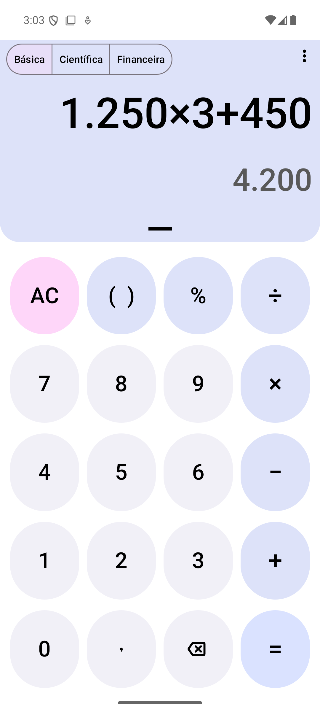
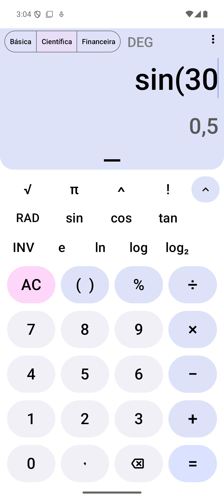
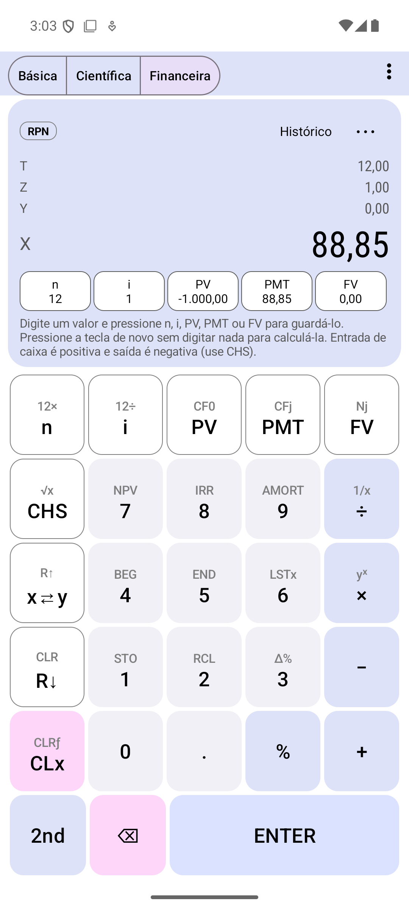
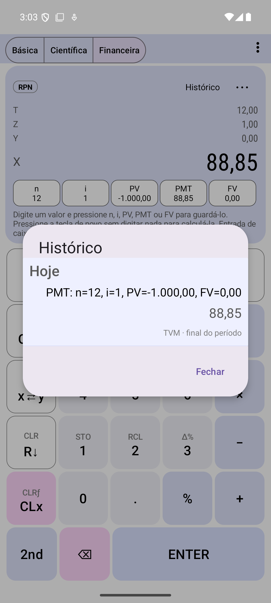

<div align="center">

# Calculadora Financeira RPN

### Calculadora básica, científica e financeira RPN para Android. 100 % offline.

*Basic, scientific and financial RPN calculator for Android. Free software (GPL-3.0), based on [OpenCalc](https://github.com/Darkempire78/OpenCalc).*

<a href="LICENSE"></a>

</div>

> **Nome provisório.** "Calculadora Financeira RPN" é um nome de trabalho. O aplicativo não usa nome, logotipo, imagens ou desenho industrial de nenhuma calculadora comercial e não é afiliado a nenhum fabricante.

## Os três modos

Um único aplicativo, três modos que se trocam por um seletor sempre visível no topo (o último modo usado é restaurado ao abrir):

| Modo | O que oferece |
|---|---|
| **Básica** | `+ − × ÷`, porcentagem, parênteses, inverter sinal (toque longo em `−`), colar número válido, histórico, copiar resultado |
| **Científica** | tudo do básico, mais trigonometria (graus/radianos), logaritmos, potências, raízes de índice n, fatorial, π e e, módulo, inverso, memória M+/M−/MR/MC e resultado anterior |
| **Financeira RPN** | pilha X/Y/Z/T, TVM (`n`, `i`, `PV`, `PMT`, `FV`), pagamento no início ou no final, fluxo de caixa, **VPL**, **TIR**, amortização, conversão de taxas, memória 0–9 |

Também: temas claro/escuro/AMOLED/Material You, retrato e paisagem, inglês e português do Brasil, leitores de tela, histórico unificado com filtro por modo, nenhuma permissão além de vibração, nenhum anúncio e nenhuma coleta de dados.

## Capturas de tela

   

## O modo RPN em um minuto

Em **RPN** (notação polonesa reversa) você digita primeiro os números e depois a operação; não existe `=`. `ENTER` separa dois números.

```
2 ENTER 3 +          →  5
```

Financiamento de 1000 em 12 parcelas de 1 % ao mês:

```
1000 CHS PV
12 n
1 i
0 FV
PMT                  →  88,85
```

`CHS` troca o sinal. **Convenção de sinais:** dinheiro que entra é positivo e dinheiro que sai é negativo; PV e PMT precisam ter sinais opostos. O aplicativo **nunca troca um sinal sozinho**: se os sinais forem incompatíveis, ele explica o problema.

Guia completo: [docs/RPN_GUIDE.md](docs/RPN_GUIDE.md).

## Requisitos

- **Para usar:** Android 5.0 (API 21) ou superior.
- **Para compilar:** JDK 17, Android SDK com plataforma 35 e build-tools 35, e acesso à internet na primeira compilação (Gradle e dependências; a biblioteca do painel deslizante vem do JitPack).

## Como compilar

```bash
./gradlew assembleDebug            # APK de depuração em app/build/outputs/apk/debug
./gradlew testDebugUnitTest        # testes unitários (JVM)
./gradlew lintDebug                # análise estática (Android Lint)
./gradlew connectedDebugAndroidTest   # testes de interface (precisa de emulador ou aparelho)
./gradlew assembleRelease bundleRelease   # release (ver abaixo)
```

No Windows use `gradlew.bat`. Crie `local.properties` com `sdk.dir=...` (o arquivo é ignorado pelo git) se o Android Studio não o criar.

**Release.** A assinatura fica **fora do repositório**: crie `keystore.properties` (ignorado pelo git) ou aponte a variável `KEYSTORE_PROPERTIES` para um arquivo em outro lugar, com `storeFile`, `storePassword`, `keyAlias` e `keyPassword`. Sem ele, a build de release sai **sem assinatura**. Detalhes e lista de conferência: [docs/RELEASE_CHECKLIST.md](docs/RELEASE_CHECKLIST.md). Nada é publicado automaticamente.

## Como contribuir

1. Abra uma issue descrevendo a mudança (para mudanças grandes, antes de programar).
2. Mantenha as mudanças pequenas e testáveis; rode `testDebugUnitTest` e `lintDebug` antes de enviar.
3. Cálculos novos precisam de testes com **valores esperados independentes** (fórmula fechada ou outra ferramenta), nunca só a saída do próprio código. Veja [docs/FINANCIAL_TEST_CASES.md](docs/FINANCIAL_TEST_CASES.md).
4. Texto novo vai em `strings.xml` (inglês) e `values-pt-rBR/strings.xml`; o teste `StringResourcesTest` confere os dois.
5. O código fica sob GPL-3.0: contribuições são aceitas sob a mesma licença.

Arquitetura: [docs/ARCHITECTURE.md](docs/ARCHITECTURE.md). Funções financeiras: [docs/FINANCIAL_FUNCTIONS.md](docs/FINANCIAL_FUNCTIONS.md).

## Limitações conhecidas

- Esta versão **não tem funções de data** (juros por dias corridos, `ΔDYS`, `DATE`).
- Taxas diárias usam ano de 365 dias; não há convenção de dias úteis.
- Fluxo de caixa: até 80 entradas, cada uma repetida de 1 a 99 vezes. A TIR é procurada entre −99 % e 100000 % por período; com várias raízes o aplicativo informa a ambiguidade em vez de escolher uma.
- O motor algébrico (básico e científico) calcula funções trigonométricas e logarítmicas em `double` (≈ 15 dígitos); só o modo financeiro usa 34 dígitos.
- O modo básico não repete a última operação ao pressionar `=` de novo, e não há `CE` separado de `AC`.
- Textos novos existem em inglês e português do Brasil; nos demais idiomas herdados do OpenCalc eles aparecem em inglês.
- O som de teclas não existe (não havia infraestrutura no projeto original); o retorno tátil existe.
- Os atalhos de avaliar, traduzir e comunidade do OpenCalc foram ocultados porque apontam para outro aplicativo.

## Privacidade

Funciona offline, sem conta, sem anúncios e sem coleta. Permissão única: `VIBRATE`. Detalhes em [docs/PRIVACY.md](docs/PRIVACY.md).

## Licença e atribuição

Software livre sob a **GNU General Public License v3.0** ([LICENSE](LICENSE)).

Este projeto é um **trabalho derivado do [OpenCalc](https://github.com/Darkempire78/OpenCalc)**, de Darkempire78 e colaboradores, também sob GPL-3.0; os avisos de direitos autorais e a atribuição originais foram mantidos. O que mudou está em [CHANGELOG.md](CHANGELOG.md). Bibliotecas de terceiros: [docs/THIRD_PARTY_LICENSES.md](docs/THIRD_PARTY_LICENSES.md).

## Documentação

| Documento | Conteúdo |
|---|---|
| [docs/IMPLEMENTATION_PLAN.md](docs/IMPLEMENTATION_PLAN.md) | auditoria inicial e plano por fases |
| [docs/ARCHITECTURE.md](docs/ARCHITECTURE.md) | arquitetura e decisões |
| [docs/RPN_GUIDE.md](docs/RPN_GUIDE.md) | guia da calculadora RPN |
| [docs/FINANCIAL_FUNCTIONS.md](docs/FINANCIAL_FUNCTIONS.md) | fórmulas, precisão e limites |
| [docs/FINANCIAL_TEST_CASES.md](docs/FINANCIAL_TEST_CASES.md) | casos de teste e fontes de validação |
| [docs/BASIC_MODE.md](docs/BASIC_MODE.md), [docs/SCIENTIFIC_MODE.md](docs/SCIENTIFIC_MODE.md) | comportamento dos modos básico e científico |
| [docs/PRIVACY.md](docs/PRIVACY.md) | política de privacidade |
| [docs/RELEASE_CHECKLIST.md](docs/RELEASE_CHECKLIST.md) | preparação para distribuição |
| [store/](store/) | textos, capturas e gráficos da loja (rascunhos) |
